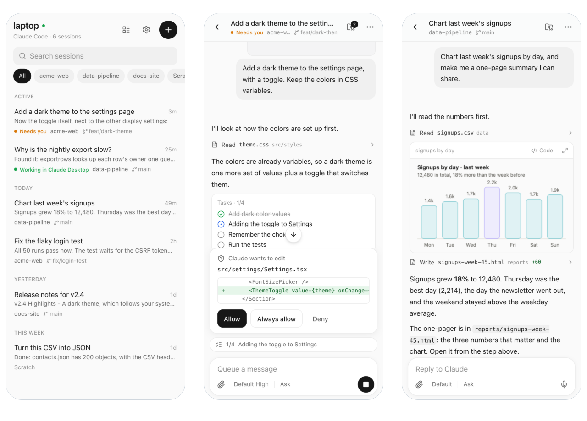
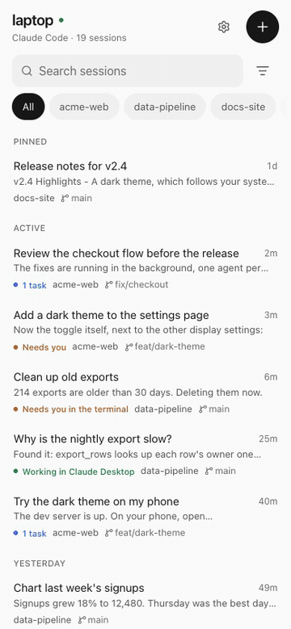

<p align="center">
  
</p>

<h1 align="center">Pelican</h1>

<p align="center">
  <b>Claude Code, in your pocket.</b><br>
  A phone-first web app for the Claude Code on your computer. Follow every session live, answer Claude, approve its edits.
</p>

<p align="center">
  <a href="https://ki-seki.github.io/pelican/demo/"><b>Live demo</b></a> ·
  <a href="https://ki-seki.github.io/pelican/">Website</a> ·
  <a href="https://ki-seki.github.io/pelican/docs.html">Docs</a>
</p>

<p align="center">
  <a href="https://www.npmjs.com/package/pelican-cc"></a>
  <a href="https://github.com/Ki-Seki/pelican/actions/workflows/ci.yml"></a>
  <a href="LICENSE"></a>
</p>

<a href="https://ki-seki.github.io/pelican/demo/">
<picture>
  <source media="(prefers-color-scheme: dark)" srcset="https://raw.githubusercontent.com/Ki-Seki/pelican/main/docs/shots/phone-dark.png">
  
</picture>
</a>

## Why Pelican

- **Every session, wherever you started it.** The terminal, Claude Desktop, your editor: Pelican
  reads Claude Code's own transcripts, so every session is there, live while it runs, with its
  whole history back past each compaction. No wrapper command, no flag to remember.
- **Nothing in between.** One small process on your computer: no account, no relay server, no copy
  of your sessions. Reach it over Tailscale, an SSH tunnel or your own proxy.
- **All of Claude Code.** Approvals with the diff, steer or queue while Claude works, `!` commands,
  changes and files, rewind code, branches, subagents, MCP servers, usage limits, every model and
  mode, `/` commands and `@` files. Charts Claude draws and pages it writes render right in the
  conversation. It runs on the official Agent SDK, so your login, settings, `CLAUDE.md`, skills and
  MCP servers apply.
- **Made for a phone.** Calm and quick with one hand. A notification when Claude needs you,
  dictation, and a Home Screen icon that opens it like an app.

<p align="center">
  
</p>

## Quick start

```bash
npx pelican-cc --demo          # made-up sessions; nothing of yours involved
npm install -g pelican-cc      # Node 22.12+, with Claude Code signed in
pelican                        # http://localhost:7860
```

Then [use it from your phone](https://ki-seki.github.io/pelican/docs.html#phone); with Tailscale it
takes two commands.

## Docs

[Using Pelican](https://ki-seki.github.io/pelican/docs.html#using) ·
[configuration](https://ki-seki.github.io/pelican/docs.html#config) ·
[security](https://ki-seki.github.io/pelican/docs.html#security) ·
[how it works](https://ki-seki.github.io/pelican/docs.html#how) ·
[compared with Remote Control, Happy and CloudCLI](https://ki-seki.github.io/pelican/docs.html#compare)

## Contributing

```bash
npm ci && npm run dev    # the server and the web app, both reloading on change
npm test && npm run typecheck
```

See [CONTRIBUTING.md](CONTRIBUTING.md). Security reports go through
[SECURITY.md](SECURITY.md).

## License

[MIT](LICENSE). Pelican is an independent project, not made by or affiliated with Anthropic.
