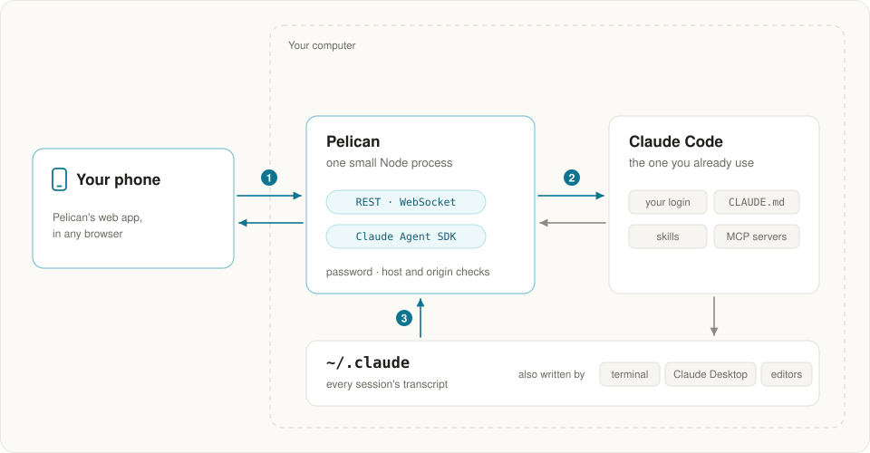

<p align="center">
  
</p>

<h1 align="center">Pelican</h1>

<p align="center">
  <b>Every Claude Code session on your computer, on your phone.</b><br>
  No wrapper, no relay, no account.
</p>

<p align="center">
  <a href="https://ki-seki.github.io/pelican/demo/"><b>Try the live demo</b></a> ·
  <a href="https://ki-seki.github.io/pelican/">Website</a> ·
  <a href="https://ki-seki.github.io/pelican/docs.html">Docs</a>
</p>

<p align="center">
  <a href="https://www.npmjs.com/package/pelican-cc"></a>
  <a href="https://github.com/Ki-Seki/pelican/actions/workflows/ci.yml"></a>
  <a href="LICENSE"></a>
</p>

<p align="center"><a href="https://ki-seki.github.io/pelican/demo/">
<picture>
  <source media="(prefers-color-scheme: dark)" srcset="https://raw.githubusercontent.com/Ki-Seki/pelican/main/docs/shots/phone-dark.png">
  
</picture>
</a></p>

## Get started

You need macOS or Linux (WSL works too), Node 22.12 or newer, and
[Claude Code](https://code.claude.com/docs/en/setup) installed and signed in: Pelican runs yours.

**1. Install and start it** on the computer where you use Claude Code:

```sh
npm install -g pelican-cc
pelican
```

Open the link it prints. Your sessions are already there. The first start fetches Anthropic's
Agent SDK from npm, which Pelican runs Claude Code through: about 5 MB, once for each version.

**2. Open it on your phone.** Put [Tailscale](https://tailscale.com/download) on the computer and
the phone, signed in to the same account, then:

```sh
tailscale serve --bg 7860
pelican phone
```

Scan the QR code with the phone's camera: Pelican opens, signed in. The phone cannot open it?
[Here is why](https://ki-seki.github.io/pelican/docs/phone.html#cannot-open), usually another VPN or
proxy on the phone. Not using Tailscale? [An SSH tunnel or your own proxy](https://ki-seki.github.io/pelican/docs/phone.html) works too.

**3. Keep it running**, if you like: `pelican service install` starts it at login.

Just looking? The [live demo](https://ki-seki.github.io/pelican/demo/) is the real app with
made-up sessions, in your browser.

## Why Pelican

- **Every session, wherever you started it.** The terminal, Claude Desktop, your editor: they all
  show up, live, with their whole history. Pick one up from your phone once it is idle.
- **All of Claude Code.** Approve edits with the diff, answer Claude's questions, queue messages
  while it works, rewind and fork. Your settings, `CLAUDE.md`, skills and MCP servers apply.
- **Nothing in between.** Pelican runs on your computer, next to Claude Code, through the official
  Agent SDK. Your phone connects to it directly. No relay, no account, no telemetry.
- **Made for a phone.** One hand, dictation, a notification when Claude needs you, a terminal with
  a key row, and a Home Screen icon. On a computer, everything sits side by side.

<p align="center">
  
</p>

## What you can do

- Approve edits and commands with the diff; answer plans and questions with a tap
- Send now, or queue for later while Claude works
- Quote a passage with a note, or ask in a side chat, as in Claude Desktop
- See the changes, read the files, and use a terminal beside the conversation
- Look at the charts, pages and files Claude makes, in place
- Rewind and fork; `!` commands, `/` commands and skills, `@` files
- Follow subagents, workflows and background tasks
- Use every model and permission mode, with any login: a Claude plan, an API key, Bedrock, Google
  Cloud or Microsoft Foundry
- See your usage by project, model and app

What it covers of Claude Code, and what it does not, is in
[the full table](https://ki-seki.github.io/pelican/docs/coverage.html).

## How it works

<p align="center">
  
</p>

Pelican is one small server next to Claude Code. It reads the transcripts Claude Code keeps in
`~/.claude`, so it sees every session, and continues them through the official Agent SDK. It
listens only on `127.0.0.1`, and every browser signs in.

## Compared with

As each project documents it, checked on 5 November 2026:

| | Your sessions | Between phone and computer | Agents | License |
| --- | --- | --- | --- | --- |
| **Pelican** | All of them, from any app, with their whole history | Nothing: Tailscale, an SSH tunnel or your proxy | Claude Code | MIT |
| [Remote Control](https://code.claude.com/docs/en/remote-control) | Those with Remote Control turned on; Claude plans only | Anthropic's servers, which keep the transcript while connected | Claude Code | Part of Claude Code |
| [Yep Anywhere](https://github.com/kzahel/yepanywhere) | Resumes those from the CLI, VS Code and desktop apps | Nothing, or its end-to-end encrypted relay | Claude Code, Codex | MIT |
| [Happy](https://github.com/slopus/happy), [HAPI](https://github.com/tiann/hapi) | Those started in Happy or HAPI | An end-to-end encrypted relay, or with HAPI your own tunnel | Claude Code, Codex and more | MIT, AGPL-3.0 |
| [CloudCLI](https://github.com/siteboon/claudecodeui) | Every session in `~/.claude` | Nothing on your network, or CloudCLI Cloud | Claude Code, Cursor CLI, Codex | AGPL-3.0 |
| SSH and tmux | The ones running in tmux | Nothing | Any | |

Remote Control can answer a prompt waiting in your terminal; Pelican cannot.

## Questions

**Does it work with my Claude plan?** Yes. Pelican runs Anthropic's own Claude Code, unmodified,
signed in the way you signed in to `claude`, and never sees your credentials. What you send from
Pelican is Agent SDK usage and counts toward your plan's limits, as
[Anthropic's help center](https://support.claude.com/en/articles/15036540) says.

**Which Claude Code does it run?** Yours, the `claude` your terminal runs, so `claude update`
updates it, and Pelican itself stays small. Pelican says when yours is older than the one it was
tested with.

**Why not Remote Control?** Use it to answer, from your phone, the prompt waiting in your terminal:
Pelican cannot. Pelican shows every session without turning anything on, keeps nothing on anyone's
servers, and works with any login.

**Why not SSH and tmux?** That works. Pelican is for what a terminal on a phone does badly: long
transcripts, diffs, one-tap approvals, notifications, and charts.

**What if my computer sleeps?** Then nothing runs. Pelican keeps it awake while Claude works; to
reach it any time, keep the computer awake, as [the docs](https://ki-seki.github.io/pelican/docs/install.html#running)
show.

**Does it cost anything, or phone home?** No. It is free and MIT licensed, with no account and no
telemetry.

[More questions](https://ki-seki.github.io/pelican/docs/faq.html)

## Security

Whoever can use Pelican can run commands as you, so it keeps everyone else out: it listens on
`127.0.0.1`, every browser signs in, requests must come from its own page, what Claude writes
renders in a sandbox, and a folder runs nothing of its own until you trust it. The whole model is
in [SECURITY.md](SECURITY.md).

## Contributing

```sh
npm ci
npm run dev
```

`npm test` and `npm run typecheck` check a change. See [CONTRIBUTING.md](CONTRIBUTING.md).

## License

[MIT](LICENSE). Pelican is an independent project, not made by or affiliated with Anthropic. The
packages built into it keep their own licenses, each given in full in `THIRD_PARTY_NOTICES` in the
npm package. Anthropic's Agent SDK, which Pelican fetches from npm, is under Anthropic's terms.
